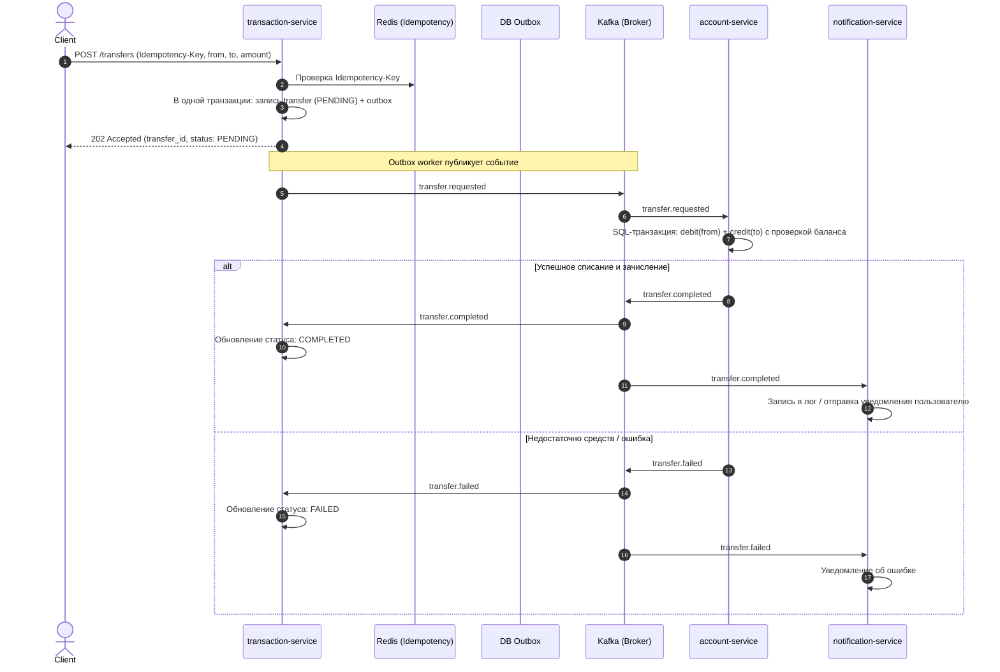

# Bank Microservices (Go)

Банковская микросервисная система на Go с распределенной архитектурой, паттерном Saga (оркестрация через Apache Kafka) и Transactional Outbox.

---

## Архитектура системы

Система состоит из 4 микросервисов:

1. **auth-service**:
   - Регистрация, логин, выпуск JWT (access + refresh).
   - **PostgreSQL**: таблица пользователей, хеши паролей (bcrypt/argon2).
   - **Redis**: хранение refresh-токенов, blacklist токенов, rate limiting.

2. **account-service**:
   - Управление счетами и балансами, история операций.
   - **PostgreSQL**: accounts (`id`, `user_id`, `currency`, `balance`, `version`), история транзакций.
   - **Redis**: кэш баланса с инвалидацией.
   - **Kafka Consumer**: слушает событие `transfer.requested`, выполняет атомарный debit/credit.

3. **transaction-service**:
   - Переводы между счетами, идемпотентность, оркестрация саги.
   - **PostgreSQL**: transfers (`id`, `from_account_id`, `to_account_id`, `amount`, `status`), outbox-таблица.
   - **Redis**: защита от двойного перевода по `Idempotency-Key`.
   - **Kafka**: продюсер `transfer.requested`, консьюмер результатов (`transfer.completed` / `transfer.failed`).

4. **notification-service**:
   - Аудит и отправка уведомлений клиентам.
   - **Kafka Consumer**: слушает события завершения/ошибок переводов.
   - **PostgreSQL**: журнал уведомлений.
   - **Redis**: дедупликация входящих событий.

---

## Поток перевода (Saga через Kafka)



---

## Структура проекта (Monorepo)

```text
bankProject/
├── .github/workflows/       # GitHub Actions CI пайплайны
├── deploy/                  # Инфраструктура (docker-compose)
├── pkg/                     # Общие библиотеки
│   ├── config/              # Загрузка конфигураций
│   ├── kafka/               # Kafka helpers (producer / consumer)
│   ├── logger/              # Логирование (slog)
│   └── middleware/          # JWT Middleware
├── services/
│   ├── auth/                # Сервис авторизации
│   ├── account/             # Сервис счетов и балансов
│   ├── transaction/         # Сервис переводов (Outbox + Saga)
│   └── notification/        # Сервис уведомлений
├── Makefile                 # Команды сборки и запуска
├── .editorconfig
├── .gitignore
├── go.mod
└── README.md
```

### Слоистая архитектура микросервиса

Внутри каждого сервиса (`services/<service-name>/`):
- `cmd/main.go`: точка входа, инициализация зависимостей и запуск сервиса.
- `internal/handler/`: транспортный слой (HTTP эндпоинты, DTO, валидация запросов).
- `internal/service/`: слой бизнес-логики и правил домена.
- `internal/repository/`: слой работы с хранилищами (PostgreSQL, Redis, Outbox).
- `internal/model/`: доменные сущности и типы.
- `internal/consumer/` / `internal/producer/`: компоненты обмена сообщениями через Kafka.
- `migrations/`: SQL-файлы миграций базы данных.
- `Dockerfile`: многоэтапный Docker-образ сервиса.

---

## Быстрый старт

### 1. Запуск инфраструктуры
```bash
make up
```
Запустятся:
- **PostgreSQL**: `localhost:5432`
- **Redis**: `localhost:6379`
- **Kafka (KRaft)**: `localhost:9092`
- **Kafka UI**: `http://localhost:8080`

### 2. Тестирование и сборка
```bash
make test
make build
```
